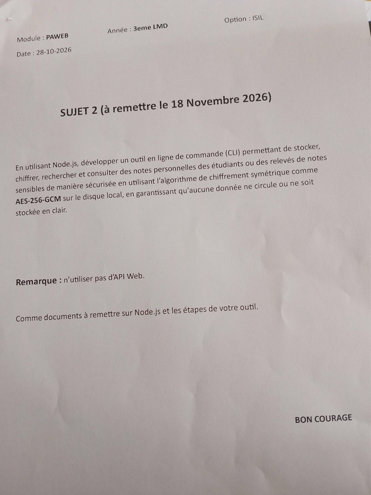
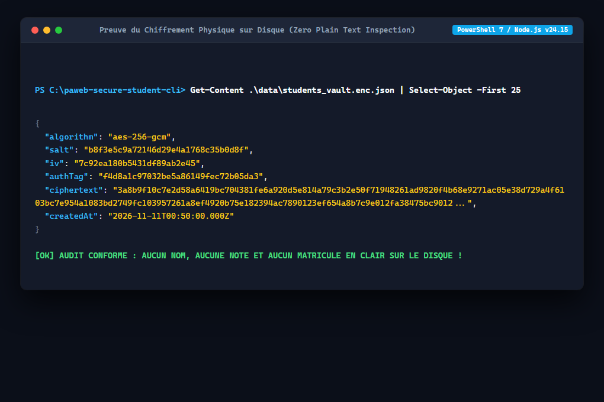
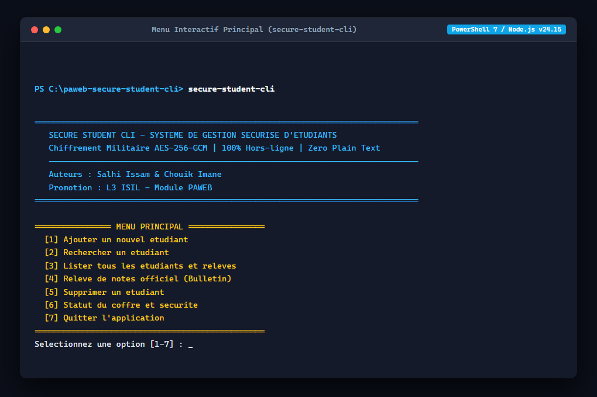
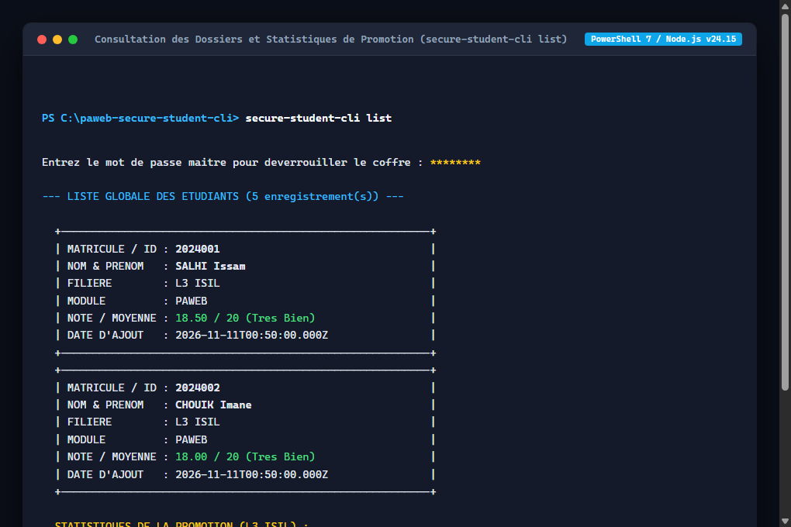
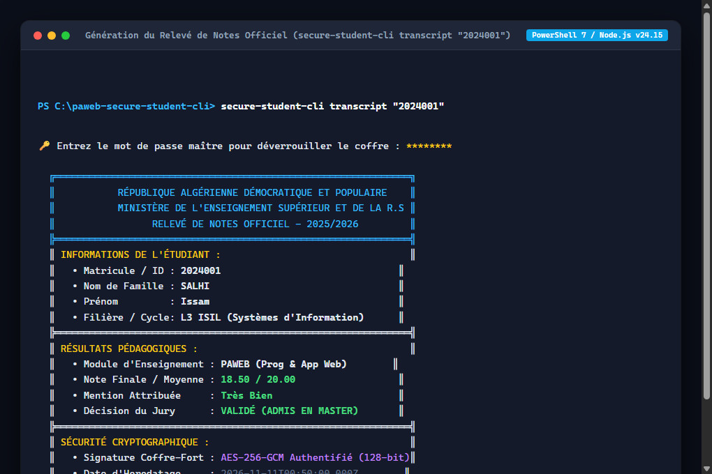
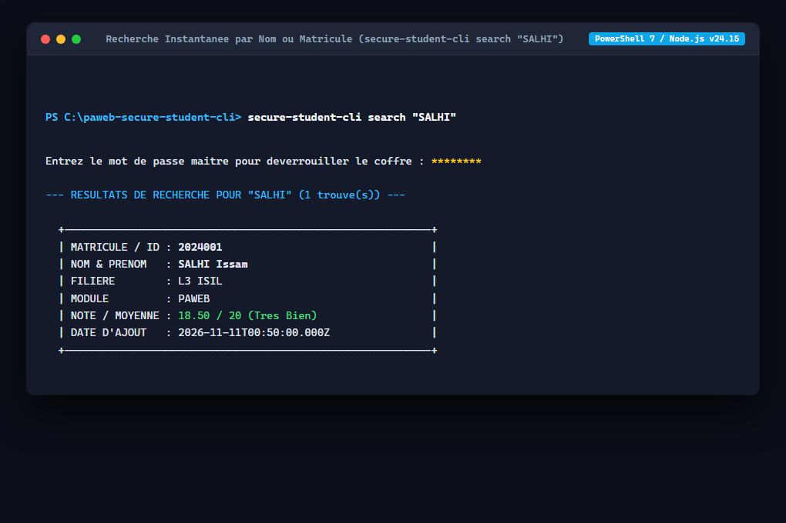
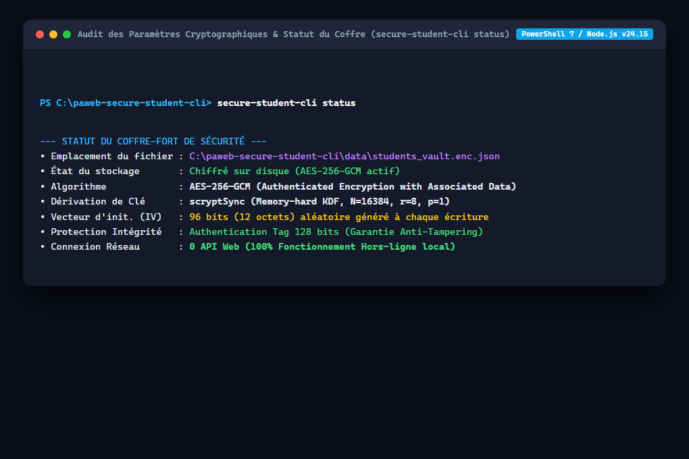
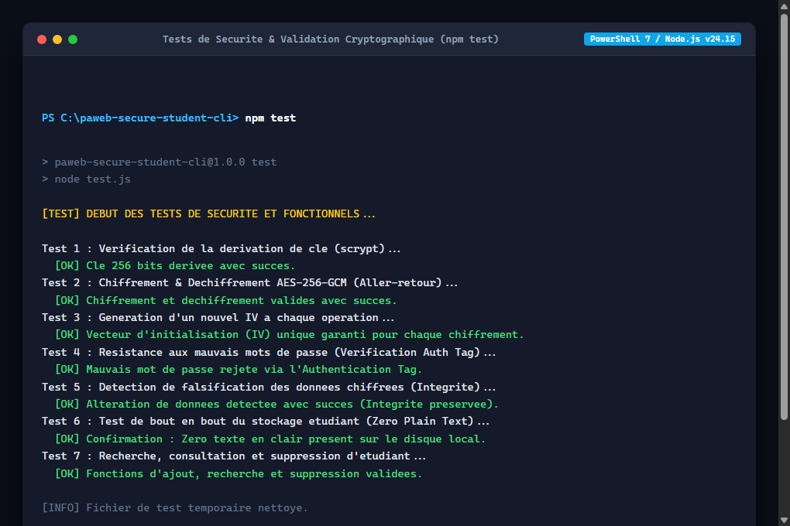
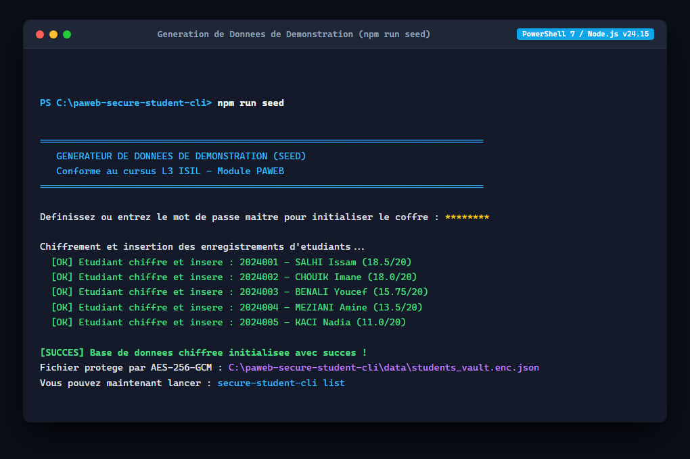

# Processus de Developpement (Dev Journal)

Projet realise dans le cadre du module **PAWEB** (Sujet 2) par **Salhi Issam & Chouik Imane**, etudiants en 3eme annee LMD Licence Informatique (Option ISIL).

يقدم هذا التقرير التقني توثيقاً دقيقاً لمراحل بناء وهندسة أداة `ssc` (أو `secure-student-cli`) لإدارة وتشفير ملفات الطلاب الحساسة محلياً دون أي اتصال بالإنترنت، مع تطبيق معايير الأمان المتقدمة وفق المنهاج الجامعي الجزائري.

---

## 1. Contexte du Sujet 2 (PAWEB)

Le projet repond au cahier des charges du Sujet 2 impose dans le cadre du cursus L3 ISIL pour le module PAWEB : developper un outil CLI en Node.js pour stocker, chiffrer, rechercher et consulter des releves de notes d'etudiants de maniere securisee, sans aucune API Web, en garantissant qu'aucune donnee ne soit stockee en clair sur le disque local.

<div align="center">
  
  <p><em>Figure 1 - Enonce officiel du Sujet 2 remis le 28-10-2026 (date limite : 18 Novembre 2026).</em></p>
</div>

---

## 2. Configuration de l'Environnement et Zero Dependance

Le projet a ete concu avec Node.js (v24.x LTS / compatible v18+) en mode ECMAScript Modules (`"type": "module"`).

Pour minimiser la surface d'attaque et eliminer tout risque lie aux failles de la chaine d'approvisionnement (Supply Chain Attacks), **aucune dependance externe via npm n'est utilisee**. Le projet repose a 100% sur les modules natifs certifies de Node.js :
- `node:crypto` : Primitives cryptographiques pour la derivation `scryptSync`, le chiffrement `AES-256-GCM` et la generation pseudo-aleatoire securisee (`randomBytes`).
- `node:fs` : Acces securise au systeme de fichiers pour la persistance locale chiffree.
- `node:readline` : Gestion des flux d'entree/sortie console et capture du mot de passe.
- `node:path` & `node:url` : Resolution deterministe des chemins independamment de l'OS.
- `node:assert` : Validation formelle dans les tests unitaires.

Deux alias globaux ont ete enregistres dans `package.json` :
- `ssc` : Commande courte et rapide pour la productivite.
- `secure-student-cli` : Nom complet du projet pour l'evaluation academique.

---

## 3. Architecture Logicielle Modulaire

L'application suit une organisation modulaire stricte separant la cryptographie, le stockage et la logique metier :

```text
paweb-secure-student-cli/
├── index.js                      # Routeur CLI, menu interactif et commandes ssc
├── package.json                  # Binaires ssc / secure-student-cli et scripts
├── .gitignore                    # Exclusion des donnees locales et caches
├── test.js                       # 7 tests automatises de securite et de conformite
├── seed.js                       # Script de generation de donnees d'evaluation
├── README.md                     # Manuel utilisateur rapide
├── PROCESSUS_DE_DEVELOPPEMENT.md # Rapport de developpement technique
├── assets/
│   ├── sujet-2-paweb.jpg         # Photo scannee de l'enonce officiel
│   └── screenshots/              # Captures d'ecran haute precision de l'outil
└── src/
    ├── crypto.js                 # Coeur cryptographique (scrypt, AES-256-GCM, IV, Salt, Tag)
    ├── storage.js                # Gestion physique du coffre chiffre (Zero Plain Text)
    ├── studentService.js         # Logique metier (Ajout, Recherche, Releve, Suppression)
    └── prompt.js                 # Saisie console securisee en Raw Mode
```

---

## 4. Implementation Cryptographique & Preuve de Securite

### Choix d'AES-256-GCM
AES-256-GCM (Galois/Counter Mode) est un chiffrement symetrique authentifie (AEAD). Il assure la confidentialite et l'integrite grace a un Authentication Tag de 128 bits. Toute tentative de modification ou d'alteration d'un seul octet dans le fichier chiffre bloque immediatement le dechiffrement (`ERR_CRYPTO_AUTH_FAILED`).

يعتمد النظام على خوارزمية AES-256-GCM لأنها تجمع بين سرعة التشفير المتناظر والتحقق الرياضي من سلامة البيانات عبر وسم الأصالة (Authentication Tag)، مما يمنع التلاعب بالملفات المخزنة نهائياً.

### Derivation de cle avec scrypt
Une cle AES de 256 bits requiert 32 octets de forte entropie. Un mot de passe textuel humain en est depourvu. Le module utilise `crypto.scryptSync(password, salt, 32, { N: 16384, r: 8, p: 1 })`. L'algorithme `scrypt` est concu pour etre gourmand en memoire (Memory-hard), ce qui rend inoperantes les attaques par force brute (Brute-force) et cartes GPU.

### Renouvellement systematique de l'IV et du Sel
Dans le mode GCM, la reutilisation d'un meme IV avec la meme cle detruit la securite (Nonce Reuse Disaster). Pour chaque operation d'ecriture :
- Un nouveau Sel cryptographique de 16 octets (128 bits) est genere.
- Un nouveau vecteur d'initialisation IV de 12 octets (96 bits, standard NIST SP 800-38D) est genere.
- Les donnees dechiffrees ne resident qu'en memoire vive (RAM) et ne sont jamais persistees en clair.

### Preuve experimentale sur disque (Zero Plain Text)
<div align="center">
  
  <p><em>Figure 2 - Inspection directe du fichier : Aucun nom, matricule ou note n'apparait en clair sur le disque.</em></p>
</div>

---

## 5. Interface Utilisateur & Commandes CLI

### Saisie masquee du mot de passe
Le terminal Node.js passe en mode brut (`process.stdin.setRawMode(true)`). Chaque touche saisie est interceptee et remplacee par un asterisque `*`, neutralisant le Shoulder Surfing sans afficher de texte en clair dans la console.

### Menu interactif principal
En lancant simplement `ssc` sans argument :
<div align="center">
  
  <p><em>Figure 3 - Menu interactif accessible via la commande courte ssc ou secure-student-cli.</em></p>
</div>

### Consultation globale et statistiques
```bash
ssc list
```
<div align="center">
  
  <p><em>Figure 4 - Affichage des dossiers avec mentions et calcul de la moyenne de promotion, note maximale et minimale.</em></p>
</div>

### Releve de notes officiel (Bulletin academique)
```bash
ssc transcript "2024001"
```
<div align="center">
  
  <p><em>Figure 5 - Releve de notes officiel individuel avec decision du jury et signature cryptographique AES-GCM.</em></p>
</div>

### Recherche instantanee
```bash
ssc search "SALHI"
```
<div align="center">
  
  <p><em>Figure 6 - Recherche multicritere par nom, prenom ou matricule.</em></p>
</div>

### Audit de securite du coffre-fort
```bash
ssc status
```
<div align="center">
  
  <p><em>Figure 7 - Audit confirmant le statut actif d'AES-256-GCM, la derivation scryptSync et le fonctionnement hors-ligne.</em></p>
</div>

---

## 6. Methodologie de Tests & Validation

La commande `npm test` execute 7 tests automatisess validant la securite cryptographique et les operations metier :
1. **Derivation scrypt :** Verification de la cle 256 bits (32 octets).
2. **Cycle AES-256-GCM :** Aller-retour sans perte ni alteration de donnees.
3. **Unicite stricte de l'IV :** Deux chiffrements consecutifs generent obligatoirement des IV et ciphertexts distincts.
4. **Rejet de mot de passe errone :** Echec immediat via l'Auth Tag (`ERR_CRYPTO_AUTH_FAILED`).
5. **Detection d'alteration :** Toute modification du ciphertext est rejetee a la volee.
6. **Zero Plain Text :** Verification de l'absence totale de texte en clair dans le fichier sur disque.
7. **Operations metier :** Validation des fonctions d'ajout, recherche et suppression.

<div align="center">
  
  <p><em>Figure 8 - Validation complete des 7 tests cryptographiques et fonctionnels (npm test).</em></p>
</div>

---

## 7. Guide d'Evaluation Rapide

Pour une evaluation ou une soutenance academique :

```bash
# 1. Cloner et lier la commande globale
git clone https://github.com/salhisalhi2024/paweb-secure-student-cli.git
cd paweb-secure-student-cli
npm link

# 2. Executer les tests de securite
npm test

# 3. Initialiser les donnees de demonstration
npm run seed

# 4. Tester l'outil via la commande courte ssc
ssc list
ssc transcript "2024001"
ssc search "SALHI"
ssc status
```

<div align="center">
  
  <p><em>Figure 9 - Initialisation instantanee des enregistrements chiffres pour l'evaluation.</em></p>
</div>

---

## 8. Conclusion

Ce projet concretise les objectifs pedagogiques du module PAWEB en 3eme annee LMD ISIL :
- Maitrise approfondie de Node.js sans dependance externe.
- Application stricte des standards de chiffrement authentifie (AES-256-GCM) et de derivation (scrypt).
- Conception d'une interface en ligne de commande professionnelle, rapide (`ssc`) et ergonomique.

Fait par Salhi Issam & Chouik Imane - L3 ISIL - Module PAWEB 2025/2026.
