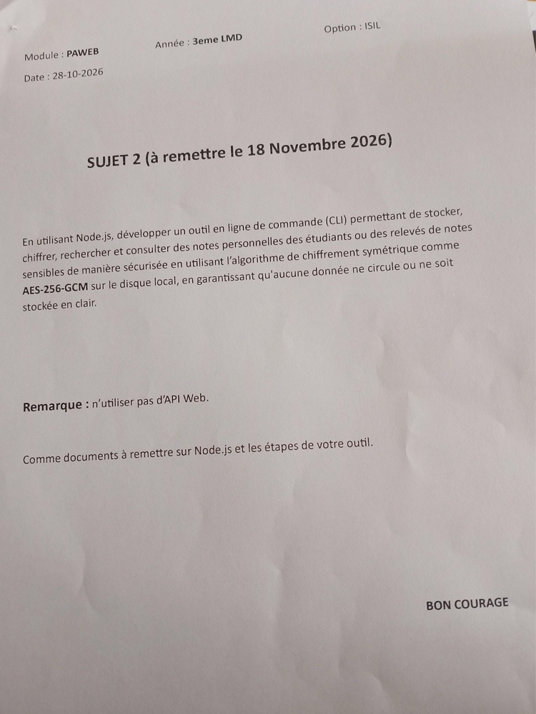

# 🔐 Secure Student CLI | أداة الإدارة الآمنة لملفات الطلاب والدرجات

> **FR :** Outil en ligne de commande (CLI) sécurisé pour le stockage, le chiffrement et la consultation des relevés de notes d'étudiants.  
> **AR :** أداة سطر أوامر (CLI) مؤمّنة بالكامل لتخزين، وتشفير، والبحث، واستعراض كشوف نقاط وسجلات الطلاب الحساسة محلياً.

---

### 👨‍💻 Contexte Académique & Auteurs | السياق الأكاديمي والطلبة المساهمون
- **Auteurs / الطلبة المنجزون :** Salhi Issam & Chouikha Imane
- **Niveau / المستوى الدراسي :** 3ème année LMD Licence Informatique (L3 ISIL)
- **Module / المقياس :** PAWEB (Programmation et Applications Web) – جامعة الجزائر / الجامعات الجزائرية
- **Projet / المشروع :** Sujet 2 – Système de gestion locale sécurisée de relevés de notes (الموضوع رقم 2)
- **Date limite de remise / تاريخ التسليم النهائي :** 18 Novembre 2026

---

## 📄 Énoncé Officiel du Projet (Sujet 2) | نص الموضوع الرسمي

<div align="center">
  
  <p><em>FR : Figure 1 – Sujet officiel n°2 distribué dans le cadre du module PAWEB (L3 ISIL).<br>AR : صورة 1 – الورقة الرسمية للموضوع الثاني لمقياس PAWEB للسنة الثالثة لسانس ISIL.</em></p>
</div>

---

## 🎯 Objectifs Pédagogiques & Conformité | الأهداف البيداغوجية ومطابقة المنهاج

| Exigence du Sujet / متطلبات الموضوع | Implémentation dans l'outil / طريقة الإنجاز في النظام | Conformité / المطابقة |
| :--- | :--- | :---: |
| **Node.js CLI** (سطر أوامر) | Interface CLI autonome en Node.js avec mode interactif et sous-commandes. | 100% |
| **AES-256-GCM** (تشفير موثق) | Chiffrement symétrique authentifié AEAD avec clé 256 bits et Auth Tag 128 bits. | 100% |
| **Zéro API Web** (100% بدون إنترنت) | Fonctionnement hors-ligne strict, aucune requête HTTP, zéro dépendance externe. | 100% |
| **Zéro texte en clair** (انعدام النص الصريح) | Aucun nom, matricule ou note n'est stocké en clair sur le disque local. | 100% |
| **Mot de passe maître** (كلمة المرور) | Saisie dynamique sécurisée et masquée, dérivation par fonction `scryptSync`. | 100% |
| **IV unique par écriture** (تجديد الـ IV) | Génération d'un nouveau vecteur de 96 bits et d'un nouveau Salt à chaque sauvegarde. | 100% |

---

## 🌟 Points Forts & Garanties de Sécurité | المميزات والضمانات الأمنية

- 🛡️ **AES-256-GCM (Galois/Counter Mode) :**  
  *FR :* Assure simultanément la **confidentialité** des données et leur **intégrité** par validation d'un `Authentication Tag` de 128 bits.  
  *AR :* يوفر في آن واحد السرية المطلقة وسلامة البيانات ومنع التلاعب عبر وسم أصالة بحجم 128 بت.
- 🔑 **Dérivation de Clé Robuste (`scryptSync`) :**  
  *FR :* Dérive une clé symétrique de 32 octets (256 bits). L'algorithme `scrypt` est gourmand en mémoire (*Memory-hard*), ce qui neutralise les attaques par force brute (Brute-force) et cartes GPU.  
  *AR :* اشتقاق مفتاح تشفير بطول 256 بت؛ تتميز خوارزمية scrypt بكونها تستهلك الذاكرة الحية بشكل مكثف لمنع هجمات القوة الغاشمة وبطاقات الرسوميات المتطورة.
- 🎲 **Vecteur d'Initialisation (IV) & Sel (Salt) Uniques :**  
  *FR :* Génération dynamique de 96 bits d'IV et 128 bits de Salt à chaque enregistrement. Prévient définitivement la vulnérabilité de réutilisation d'IV (*Nonce Reuse*).  
  *AR :* توليد متجه تهيئة (IV) وملح عشوائي جديد عند كل عملية حفظ لمنع كارثة إعادة استخدام المفاتيح.
- 🚫 **Zéro Donnée en Clair sur Disque (Zero Plain Text) :**  
  *FR :* Les données déchiffrées ne résident qu'en mémoire vive (RAM) le temps du traitement et s'effacent dès la fermeture du processus.  
  *AR :* لا يتم حفظ أي معلومة بنص واضح على القرص الصلب؛ يتم استرجاع البيانات فقط في ذاكرة الرام أثناء التشغيل وتتلاشى فوراً.
- 🔌 **100% Hors-Ligne (Air-gapped / Local-only) :**  
  *FR :* Aucune connexion internet requise. Zéro transmission vers des tiers.  
  *AR :* يعمل النظام دون الحاجة إلى أي اتصال بالشبكة، مما يضمن أماناً تاماً للبيانات المدرسية الحساسة.
- 📦 **Zéro Dépendance Externe (Zero npm Dependencies) :**  
  *FR :* Développé exclusivement avec les bibliothèques officielles intégrées de Node.js (`crypto`, `fs`, `readline`). Aucune faille de chaîne d'approvisionnement.  
  *AR :* تم الاعتماد حصراً على مكتبات Node.js القياسية دون أي حزم خارجية لتفادي ثغرات الحزم الخارجية.
- 🙈 **Saisie Masquée du Mot de Passe :**  
  *FR :* Prise en charge du mode brut (*Raw Mode*) masquant la frappe par des étoiles `*` pour contrer le *Shoulder Surfing*.  
  *AR :* إخفاء كلمة المرور الرئيسية أثناء إدخالها في الطرفية واستبدالها بنجوم (*) للحماية من التلصص البصري.

---

## 🚀 Installation & Configuration Rapide | التثبيت والتشغيل السريع

```bash
# 1. Cloner le dépôt GitHub / استنساخ المستودع
git clone https://github.com/salhisalhi2024/paweb-secure-student-cli.git

# 2. Accéder au répertoire / الدخول إلى مجلد المشروع
cd paweb-secure-student-cli

# 3. Lier la commande de manière globale / ربط الأمر بالنظام عالمياً
npm link
```

🎉 **C'est prêt ! / أصبح البرنامج جاهزاً !**  
Vous pouvez désormais lancer l'outil depuis n'importe quel dossier en écrivant :  
يمكنكم تشغيل الأداة من أي مسار في الطرفية بكتابة :
```bash
secure-student-cli
```

---

## 💻 Guide d'Utilisation | دليل الاستخدام

### 1. Mode Interactif Convivial (Recommandé) | الوضع التفاعلي المباشر
Lancez la commande sans argument pour afficher le menu complet :
```bash
secure-student-cli
```
```text
================ MENU PRINCIPAL ================
  [1] ➕ Ajouter un nouvel étudiant
  [2] 🔍 Rechercher un étudiant
  [3] 📋 Lister tous les étudiants & relevés
  [4] 🎓 Relevé de notes officiel (Bulletin)
  [5] 🗑️  Supprimer un étudiant
  [6] 🛡️  Statut du coffre et sécurité
  [7] 🚪 Quitter l'application
================================================
```

---

### 2. Commandes Directes en Ligne de Commande | الأوامر المباشرة

#### ➕ Ajouter un étudiant | إضافة طالب جديد
```bash
secure-student-cli add
```
*FR :* Saisie guidée du matricule, nom, prénom, filière, module et note sur 20.  
*AR :* إدخال تفاعلي منظم: رقم التسجيل، اللقب، الاسم، التخصص، المقياس، والعلامة من 20.

#### 📋 Afficher tous les relevés & statistiques | عرض قائمة الطلاب والإحصائيات
```bash
secure-student-cli list
```
*FR :* Calcule automatiquement la moyenne générale de promotion, la note maximale et minimale.  
*AR :* عرض شامل مع حساب المعدل العام للدفعة، وأعلى وأدنى علامة مسجلة.

#### 🔍 Rechercher un étudiant | البحث عن طالب
```bash
secure-student-cli search "BENALI"
# ou recherche par matricule / أو البحث بواسطة رقم التسجيل
secure-student-cli search "2024001"
```

#### 🎓 Générer un bulletin officiel | استخراج كشف نقاط رسمي
```bash
secure-student-cli transcript "2024001"
```
*FR :* Génère une fiche académique complète avec mention (*Très Bien*, *Bien*, *Passable*...) et décision du jury.  
*AR :* توليد كشف نقاط أكاديمي رسمي يتضمن الملاحظة والتقدير وقرار لجنة المداولات.

#### 🗑️ Supprimer un étudiant | حذف طالب وإعادة تشفير الخزنة
```bash
secure-student-cli delete "2024001"
```

#### 🛡️ Consulter les paramètres cryptographiques | فحص حالة الأمان
```bash
secure-student-cli status
```

---

## 🧪 Tests Automatisés & Démonstration | حزمة الاختبارات والعرض التوضيحي

### 1. Exécution de la suite de tests | تشغيل الاختبارات الآلية
```bash
npm test
```
*FR :* Valide automatiquement 7 scénarios rigoureux (scrypt 256-bit, cycle AES-GCM, non-réutilisation de l'IV, rejet de mot de passe erroné, détection d'altération de fichier, absence de texte en clair, recherche et suppression).  
*AR :* اختبار آلي متكامل يشمل 7 مراحل للتحقق من الأمان الرياضي، وكشف التلاعب، وسلامة التخزين.

### 2. Génération de données de test immédiate (Seed) | توليد بيانات جاهزة للتقييم
```bash
npm run seed
```
*FR :* Génère instantanément 5 profils d'étudiants chiffrés pour faciliter l'évaluation par l'enseignant.  
*AR :* إنشاء فوري لخمسة طلاب مشفرين لاختبار وعرض عمل البرنامج أمام لجنة التقييم.

---

## 🗂️ Structure du Projet | هيكلية ملفات المشروع

```text
paweb-secure-student-cli/
├── index.js                      # Point d'entrée exécutable (CLI Router & Menu interactif)
├── package.json                  # Définition du projet, binaire global et scripts
├── .gitignore                    # Exclusion des fichiers temporaires et données sensibles
├── test.js                       # Suite complète de tests unitaires et cryptographiques
├── seed.js                       # Générateur de données de démonstration pour évaluation
├── README.md                     # Manuel utilisateur bilingue (Français / Arabe)
├── PROCESSUS_DE_DEVELOPPEMENT.md # Journal de bord technique approfondi selon le cursus
├── assets/
│   └── sujet-2-paweb.jpg         # Photo scannée de l'énoncé officiel du sujet
└── src/
    ├── crypto.js                 # Cœur cryptographique (AES-256-GCM, scryptSync, IV, Salt)
    ├── storage.js                # Gestion du stockage chiffré sur disque (Zero Plain Text)
    ├── studentService.js         # Logique métier (Ajout, Recherche, Relevés, Bulletins, Stats)
    └── prompt.js                 # Saisie sécurisée et masquage du mot de passe en Raw Mode
```

---

## 🔬 Synthèse Technique des Spécifications | ملخص المواصفات التقنية

| Paramètre / المعيار | Valeur / القيمة | Rôle de Sécurité / الدور الأمني |
| :--- | :--- | :--- |
| **Algorithme / خوارزمية التشفير** | AES-256-GCM | Authenticated Encryption (AEAD) : Confidentialité + Intégrité. |
| **Fonction KDF / اشتقاق المفاتيح** | `scryptSync` (N=16384, r=8, p=1) | Résistance aux attaques massives par GPU/ASIC et Brute-Force. |
| **Longueur de Clé / طول المفتاح** | 256 bits (32 octets) | Sécurité militaire maximale contre le déchiffrement non autorisé. |
| **IV (Nonce) / متجه التهيئة** | 96 bits (12 octets) aléatoires | Recommandation NIST SP 800-38D, renouvelé à chaque sauvegarde. |
| **Auth Tag / وسم الأصالة** | 128 bits (16 octets) | Détection immédiate de toute falsification ou corruption sur disque. |

---

## ⚖️ Auteurs & Licence Académique | حقوق المشروع

Projet réalisé dans le cadre du module **PAWEB** (3ème année LMD ISIL) par les étudiants :  
- **Salhi Issam**  
- **Chouikha Imane**  

Distribué sous licence **MIT** pour valorisation académique et pédagogique.
